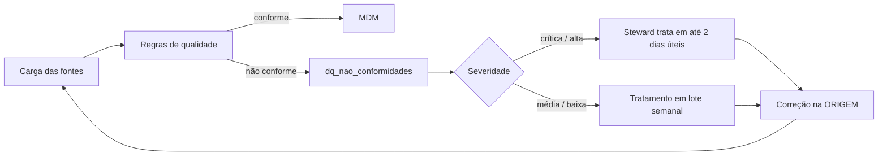

# Governança do cadastro de empresas

Quem cuida de quê no cadastro, o que fazer quando um dado falha numa regra e como os dados pessoais são tratados.

## 1. Papéis e responsabilidades (RACI)

| Atividade | Dono do dado (Comercial) | Data Steward | Analista de Qualidade | TI / Engenharia |
|---|---|---|---|---|
| Definir o que é um "cliente válido" e as metas de qualidade | **A** | R | C | I |
| Manter o catálogo de regras (`config/regras_qualidade.yaml`) | C | **A** | R | I |
| Manter as regras de match e sobrevivência (`config/sobrevivencia.yaml`) | C | **A/R** | C | I |
| Tratar a fila de não conformidades | I | **A** | R | - |
| Decidir os pares duvidosos do MDM (fila de revisão) | C | **A/R** | - | - |
| Corrigir o dado no sistema de origem (ERP) | **A** | C | - | R |
| Manter o pipeline e as integrações | I | C | C | **A/R** |

R = executa · A = responde pelo resultado · C = é consultado · I = é informado

## 2. Ciclo de vida de uma não conformidade

Algumas regras do processo:

- A correção é feita no sistema de origem, não no relatório. O pipeline padroniza formato (tira a pontuação do CEP, por exemplo), mas não completa nem troca valor. O erro continua aparecendo até ser corrigido na origem.
- Toda regra tem uma ação recomendada, para quem recebe a lista saber o que fazer.
- A severidade define a prioridade de tratamento e o peso no índice: CNPJ errado (crítica, peso 8) pesa oito vezes mais que telefone sem DDD (baixa, peso 1).
- Empresa com CNPJ baixado não é erro de dado, é um dado correto sobre um cliente com problema. Por isso a regra DQ010 só gera alerta e não entra no índice.

### Metas (SLA de qualidade)

| Dimensão | Meta | Motivo |
|---|---|---|
| Completude | 95% | Campos obrigatórios para emitir nota fiscal |
| Validade | 98% | Formato errado quebra integrações (SEFAZ, bancos) |
| Consistência | 97% | Divergências internas indicam erro de digitação |
| Unicidade | 100% | Cliente duplicado divide histórico de compras e limite de crédito |
| Atualidade | 70% | Cartões e cadastros com mais de um ano pedem revalidação, mas não bloqueiam a operação |

## 3. Master Data Management

### Por que o CNPJ é a chave de match

O CNPJ identifica o **estabelecimento** de forma única e tem dígito verificador. Quando ele é válido, dois registros com o mesmo CNPJ são a mesma entidade, sem margem de dúvida. A similaridade de nome só entra quando o CNPJ falta ou é inválido.

### Limiares do match probabilístico

| Score | Decisão | Por quê |
|---|---|---|
| ≥ 0,88 | une automaticamente | Nome praticamente igual **e** CNPJ com 1 dígito de diferença ou CEP igual. Errar aqui é raro |
| 0,65 a 0,88 | fila de revisão do Steward | Parecido, mas pode ser uma empresa diferente com nome semelhante. Unir duas empresas por engano é pior que deixar um duplicado |
| < 0,65 | quarentena | Sem CNPJ válido e sem candidato: não entra no cadastro mestre |

As decisões do Steward são gravadas em `saida_*/decisoes_steward.csv` (colunas da fila + `decisao` = `UNIR` ou `SEPARAR`) e aplicadas automaticamente na execução seguinte. A decisão humana fica registrada e é auditável.

### Sobrevivência campo a campo

| Campo | Prioridade | Justificativa |
|---|---|---|
| todos (padrão) | Receita > cartão > ERP | A Receita é a fonte legal |
| `email`, `telefone` | ERP > Receita > cartão | O contato da Receita costuma ser o do contador; o comercial mantém o contato real no ERP |
| `nome_fantasia` | Receita > ERP > cartão | Quando a Receita não tem nome fantasia, o nome usado pelo comercial é mais útil |

Desempates: a informação mais recente vence; persistindo o empate, vence o registro com melhor nota de qualidade. E um valor **só concorre se for válido**: um CEP de 7 dígitos nunca vence, mesmo que venha da fonte prioritária.

Cada valor do cadastro mestre tem linhagem registrada em `mdm_linhagem`: fonte, registro de origem, data e critério de escolha, além das alternativas que perderam.

## 4. Proteção de dados pessoais (LGPD)

| Medida | Onde |
|---|---|
| **Minimização:** o quadro de sócios (QSA) devolvido pela API não é armazenado | `mdm_cnpj/receita.py` |
| **Classificação:** cada campo tem classificação no dicionário de dados | `docs/DICIONARIO_DE_DADOS.md`, `mdm_cnpj/lgpd.py` |
| **Mascaramento:** nome e CPF de empresário individual, e-mail e telefone são mascarados em tudo o que é feito para circular (relatório HTML, RESUMO.md) | `mdm_cnpj/lgpd.py` |
| **Segregação:** a base completa (SQLite, CSVs) fica em `saida_real/`, ignorada pelo Git | `.gitignore` |
| **Dados de demonstração sintéticos:** nomes inventados e CPFs com dígito verificador propositalmente inválido | `mdm_cnpj/demo.py` |
| **Teste automatizado:** falha se aparecer um CPF ou e-mail nas saídas compartilháveis | `tests/test_pipeline_demo.py` |

Base legal do tratamento no cenário real: execução de contrato e obrigação legal (emissão de documentos fiscais para clientes).

## 5. Gestão de mudanças nas regras

1. A proposta de regra nova ou de ajuste de meta é discutida com o dono do dado.
2. A alteração entra no YAML com a versão do catálogo incrementada.
3. `python executar.py catalogo` regenera `docs/CATALOGO_DE_REGRAS.md`.
4. Os testes (`pytest`) garantem que o catálogo continua válido (ids únicos, dimensões e validadores conhecidos, toda regra com ação).
